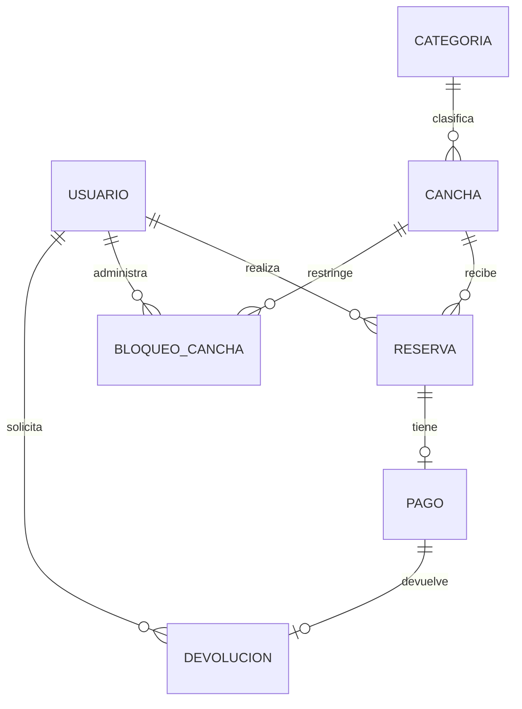

# Informe técnico final — CanchaYa

Este documento complementa el informe académico original y describe la implementación final. El PDF original se conserva sin modificaciones. El sistema es un negocio ficticio para fútbol en grass y vóley.

## Arquitectura implementada

Java con Spring MVC, JSP/JSTL y Spring JDBC. Los controladores reciben peticiones y preparan modelos; los servicios validan reglas y coordinan transacciones; repositorios/DAO ejecutan SQL parametrizado y `RowMapper` transforma filas. No se usa JPA/Hibernate ni Thymeleaf. Los cinco gráficos usan Chart.js local; todas las reglas y agregaciones están en Java/JDBC.

La cabecera se comparte entre todas las JSP. El logotipo mantiene su identidad y apunta a `/`, que decide el destino por rol. La consulta de catálogo/disponibilidad es pública. Las páginas informativas solo se muestran sin autenticación. Los formularios de negocio requieren la sesión y el rol correspondientes.

## Modelo de datos

Se conservan Usuario, Categoría, Cancha, Reserva y Pago. Se incorporan dos tablas operativas para mantenimiento y devoluciones; Contacto no agrega ninguna tabla.

| Tabla complementaria | Campos y restricciones |
| --- | --- |
| `bloqueo_cancha` | `id_bloqueo` BIGINT PK; `id_cancha` FK; `fecha` DATE; `hora_inicio`/`hora_fin` TIME; `motivo` VARCHAR(250); `estado` ACTIVO/ANULADO; `id_administrador` FK usuario; `fecha_registro` TIMESTAMP. Fin posterior al inicio. |
| `devolucion` | `id_devolucion` BIGINT PK; `id_pago` FK y UNIQUE; `importe` DECIMAL(10,2) positivo; `fecha_devolucion` TIMESTAMP; `motivo` VARCHAR(250); `id_usuario` FK del actor. Máximo una devolución por pago. |

El esquema normal es aditivo (`CREATE ... IF NOT EXISTS`), sin borrados. Los índices de reserva, usuario y bloqueo apoyan las consultas de disponibilidad. La columna de contraseña existente admite el hash sin cambiar el esquema. Las claves antiguas se migran a PBKDF2 con sal sin cambiar las credenciales. La relación Reserva–Pago permite cero o un pago; el flujo vigente registra ambos juntos y garantiza un pago para toda reserva nueva confirmada.

## Estados y flujo

1. El cliente consulta turnos de una hora entre 08:00 y 22:00.
2. Se valida la solicitud y se guarda un borrador en sesión. No crea una reserva pendiente ni retiene el horario.
3. Al confirmar el pago simulado se bloquea la fila de la cancha, se repiten las validaciones y se registran reserva CONFIRMADA y pago REGISTRADO en una transacción.
4. Si otro usuario tomó el horario, se rechaza la operación sin crear una reserva ni pago parcial.
5. El cliente puede cancelar con 24 horas exactas o más de anticipación; el administrador puede cancelar una reserva confirmada como excepción operativa.
6. La reserva pasa a CANCELADA y se registra la devolución completa simulada. El pago original conserva su importe y estado. Si falla la devolución, se revierte la cancelación.
7. La devolución única y el bloqueo de cancha impiden duplicidades incluso con solicitudes simultáneas. Las cancelaciones históricas sin devolución se regularizan desde Pagos.

`PENDIENTE` se admite para consultar registros heredados; las nuevas reservas no usan ese estado. No se simulan cobros reales ni se solicitan datos de tarjetas.

## Reglas verificadas

- **RN01:** no hay superposición para una misma cancha y fecha; un turno que termina al comenzar otro no se superpone. Los bloqueos de mantenimiento también restringen disponibilidad.
- **RN02:** el cliente debe estar activo. El estado y rol se consultan nuevamente en H2, aunque la sesión ya esté abierta.
- **RN03:** cancha y categoría activas para nuevas reservas. Inactivar conserva el historial.
- **RN04:** importe = precio por hora × duración. El precio debe ser positivo y tener hasta dos decimales. El importe queda guardado en la reserva y no se recalcula al consultar historial.
- **RN05:** reserva confirmada y pago se registran juntos. Un fallo de persistencia revierte ambas escrituras.
- Las reservas se programan en horas exactas y bloques completos de una hora. Reservas y mantenimiento deben iniciar en el futuro y estar dentro del horario de 08:00 a 22:00 en America/Lima.
- El mantenimiento permite elegir la hora y los minutos de inicio y fin. Requiere administrador activo, motivo y un intervalo sin reservas ni bloqueos activos superpuestos. No cancela reservas automáticamente.
- La edición del perfil toma el ID desde la sesión; no acepta modificar otro usuario ni rol, estado o contraseña desde ese formulario.
- No se elimina una categoría asociada a canchas. Se validan duplicados, formatos, longitudes y referencias en el servidor.

## Matriz de las 24 funcionalidades

| Código | Funcionalidad | Interfaz / rutas principales |
| --- | --- | --- |
| F01 | Registrar cliente | `/usuario/registro` GET/POST |
| F02 | Consultar clientes | `/usuario/admin/lista` |
| F03 | Actualizar cliente | `/usuario/admin/editar/{id}` y `/usuario/perfil` GET/POST |
| F04 | Bloquear/desbloquear cliente | `/usuario/admin/bloquear/{id}` POST |
| F05 | Registrar cancha | `/canchas/admin/nueva`, `/canchas/admin/guardar` POST |
| F06 | Consultar canchas | `/canchas/catalogo`, `/canchas/admin` |
| F07 | Actualizar cancha | `/canchas/admin/editar/{id}`, `/canchas/admin/guardar` POST |
| F08 | Inactivar/reactivar cancha | `/canchas/admin/estado/{id}` POST |
| F09 | Autenticar usuario | `/usuario/login` GET/POST; `/usuario/logout` POST |
| F10 | Consultar disponibilidad | `/reservas/disponibilidad` |
| F11 | Generar reserva y calcular importe | `/reservas/nueva`, `/reservas/guardar` POST, resumen de pago |
| F12 | Registrar pago y confirmar reserva | `/reservas/pago`, `/reservas/pago/procesar` POST |
| F13 | Consultar reservas propias | `/reservas/mis-reservas` |
| F14 | Consultar detalle y estado | `/reservas/mis-reservas/{id}`; incluye pago y devolución |
| F15 | Cancelar reserva propia | `/reservas/mis-reservas/{id}/cancelar` POST |
| F16 | Consulta administrativa | `/reservas/admin` y su detalle; filtros |
| F17 | Cancelación administrativa y devolución | `/reservas/admin/{id}/cancelar` POST; regularización desde Pagos |
| F18 | Gestionar disponibilidad | `/admin/disponibilidad`; bloquear/anular mediante POST |
| F19 | Consultar pagos | `/admin/pagos`; fechas, cancha y devolución |
| F20 | Cinco métricas | `/admin/metricas`, `/admin/metricas/datos` |
| F21 | Crear categoría | `/admin/categorias/guardar` POST sin ID |
| F22 | Consultar categorías | `/admin/categorias` |
| F23 | Modificar categoría | `/admin/categorias/editar/{id}`, guardar POST con ID |
| F24 | Eliminar categoría | `/admin/categorias/eliminar/{id}` POST; sin canchas asociadas |

## Cinco gráficos bidimensionales

| Gráfico | X | Y | Criterio |
| --- | --- | --- | --- |
| Reservas registradas | Fecha de registro | Cantidad por día | Incluye las posteriormente canceladas |
| Pagos registrados | Fecha de pago | Importe bruto diario en soles | Pagos REGISTRADO; conserva pagos luego devueltos |
| Horas reservadas | Fecha de uso | Horas por día | Reservas CONFIRMADA |
| Reservas por cancha | Cancha | Cantidad del período | Fecha de uso y estado CONFIRMADA |
| Reservas por categoría | Categoría actual de la cancha | Cantidad del período | Fecha de uso y estado CONFIRMADA |

Los dos primeros usan el instante de registro/pago; los otros usan fecha de uso. Los días vacíos valen cero. El rango se limita a 366 días de diferencia. Las series no son acumuladas ni apiladas. Los gráficos incluyen tablas accesibles con sus valores y filtros de fecha/cancha. Pagos ofrece por separado el importe devuelto y saldo retenido; el gráfico bruto no se presenta como ingreso neto.

## Seguridad, sesiones y límites

Identificador de sesión rotado al autenticar, expiración a 20 minutos, revalidación del usuario y rol, CSRF en todos los POST (incluido login y logout), SQL parametrizado, salida escapada, cabeceras sin caché/referrer y restricciones de contenido. Contraseñas PBKDF2 con sal; administrador académico fijo solicitado por el equipo. La consola H2 se deshabilita por defecto.

Se conservan sesiones por URL para permitir accesos independientes entre pestañas. Copiar una URL autenticada conserva la sesión; no debe compartirse. Este mecanismo y las credenciales administrativas académicas pertenecen a una demostración local; un despliegue público requeriría revisar sesiones con cookies, HTTPS, credenciales y operación de pagos reales.

Contacto es únicamente un formulario estático. La publicidad presenta imágenes generadas y no afirma que correspondan a instalaciones reales. El perfil demo es una base aislada en memoria. Los prototipos anteriores se conservan en documentación y no se empaquetan como vistas activas.

## Referencias técnicas

- [Integración de Chart.js](https://www.chartjs.org/docs/latest/getting-started/integration.html).
- [Almacenamiento de contraseñas en Spring Security](https://docs.spring.io/spring-security/reference/features/authentication/password-storage.html).

La verificación final y sus límites se registran en `VERIFICACION_FINAL.md`.
